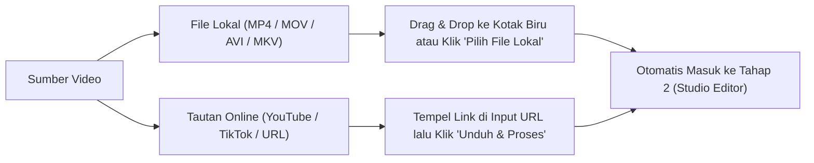
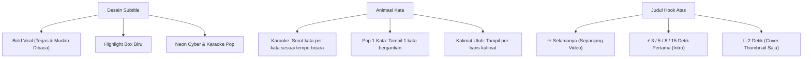

# 📖 PANDUAN LENGKAP PENGGUNAAN ENCLip
### *Native AI Video Clipper & Smart Studio Editor*

Selamat datang di panduan resmi penggunaan **ENCLip**. Dokumen ini menyajikan panduan langkah demi langkah yang lengkap, mulai dari persiapan berkas video, pengaturan gaya framing bebas dengan mouse, penataan subtitle & hook, pemotongan otomatis/manual, hingga ekspor akhir dan integrasi auto-upload.

---

## 📑 DAFTAR ISI
1. [Cara Membuka & Menjalankan Aplikasi](#1-cara-membuka--menjalankan-aplikasi)
2. [Tahap 1: Memasukkan Video Sumber](#2-tahap-1-memasukkan-video-sumber)
3. [Tahap 2: Studio Editor & Pratinjau Real-Time (User POV)](#3-tahap-2-studio-editor--pratinjau-real-time-user-pov)
   - [Sub-Tab 1: Format Framing & Gerakan Bebas Kamera](#sub-tab-1-format-framing--gerakan-bebas-kamera)
   - [Sub-Tab 2: Subtitle Otomatis & Judul Hook Fleksibel](#sub-tab-2-subtitle-otomatis--judul-hook-fleksibel)
   - [Sub-Tab 3: Suara Pembicara & Musik Latar (BGM)](#sub-tab-3-suara-pembicara--musik-latar-bgm)
   - [Sub-Tab 4: Cara Pemotongan (Otomatis AI vs Manual)](#sub-tab-4-cara-pemotongan-otomatis-ai-vs-manual)
4. [Tahap 3: Review Timeline & Koreksi Klip](#4-tahap-3-review-timeline--koreksi-klip)
5. [Tahap 4: Proses Render & Sinkronisasi Auto-Upload](#5-tahap-4-proses-render--sinkronisasi-auto-upload)
6. [Tabel Interaksi Mouse & Tombol Pintas](#6-tabel-interaksi-mouse--tombol-pintas)
7. [Tanya Jawab & Solusi Kendala (FAQ)](#7-tanya-jawab--solusi-kendala-faq)

---

## 1. CARA MEMBUKA & MENJALANKAN APLIKASI

ENCLip dapat dijalankan dalam beberapa opsi pilihan:

### A. Versi Portable (Paling Cepat & Praktis)
* Buka folder: `D:\ProjekAntigravity\ENCLip\portable\`
* Klik dua kali pada **`ENCLip.exe`**.
* *Kelebihan*: Tidak memerlukan instalasi, bebas dipindahkan ke flashdisk atau folder mana pun.

### B. Versi Native Installer (Tinggal Install .exe)
* Buka folder: `D:\ProjekAntigravity\ENCLip\Native_Installer\`
* Jalankan installer resmi Windows: **`ENCLip_Setup_v2.0_Terbaru.exe`** (atau klik file `1_ENCLip_Native_App.bat`).
* Ikuti petunjuk instalasi Windows (Next -> Install).
* Aplikasi akan otomatis terpasang di Program Files lengkap dengan Shortcut resmi di Desktop dan Menu Start Windows.

### C. Menjalankan via Terminal / Python Source
* Buka PowerShell di folder proyek:
  ```powershell
  cd D:\ProjekAntigravity\ENCLip\Desktop_UI
  C:\Python314\python.exe desktop_gui.py
  ```

---

## 2. TAHAP 1: MEMASUKKAN VIDEO SUMBER

Saat aplikasi terbuka, Anda berada di halaman pertama (**Pilih Video**):



1. **Memasukkan File Video Komputer**:
   * Tarik (*drag & drop*) file video dari File Explorer langsung ke kotak biru bertanda panah atas.
   * Atau klik tombol **`📂 Pilih File Lokal`** dan pilih berkas video Anda.
2. **Memasukkan Tautan URL (YouTube / Video Web)**:
   * Masukkan link video ke kolom *URL Video*.
   * Klik tombol **`⬇ Unduh & Proses`**. ENCLip akan mengunduh video dengan resolusi terbaik secara otomatis.
3. Setelah video termuat, ENCLip akan langsung membawa Anda ke **Tahap 2: Atur Gaya Klip & Pratinjau Live**.

---

## 3. TAHAP 2: STUDIO EDITOR & PRATINJAU REAL-TIME (USER POV)

Jendela Tahap 2 dibagi menjadi dua bagian:
* **Kolom Kiri**: Tab pengaturan (*Format & Kamera*, *Subtitle & Hook*, *Audio & Musik*, *AI & Durasi*).
* **Kolom Kanan**: Kanvas pratinjau interaktif (*User POV*) yang langsung menampilkan hasil video, subtitle, hook, dan efek secara *real-time*.

---

### SUB-TAB 1: FORMAT FRAMING & GERAKAN BEBAS KAMERA

Bagian ini menentukan bagaimana video asli (biasanya horizontal 16:9) dikonversi menjadi video vertikal (9:16 Shorts/TikTok) atau rasio lainnya.

Anda dapat memilih antara dua mode utama:
* **🤖 Framing Otomatis (AI)**
* **✋ Framing Manual (Atur Sendiri)**

#### A. Mode Framing Otomatis (AI Camera-Director)
Mode ini menggunakan kecerdasan buatan untuk membaca posisi orang yang berbicara:
1. **9:16 Auto-Podcast AI**:
   * **1 Orang**: Kamera AI otomatis mengunci wajah pembicara di tengah layar vertikal.
   * **2 Orang**: Kamera AI otomatis membagi layar menjadi 2 panel atas & bawah (*Split Screen*) dengan batas bahu dan dada yang aman.
   * **0 Wajah / Benda / Game**: Otomatis berpindah ke mode *Cinema Blur* (video utuh di tengah dengan latar belakang blur sinematik).
2. **9:16 AI Fokus 1 Pembicara**: Kamera terus mengikuti 1 pembicara utama.
3. **9:16 AI Split 2 Pembicara**: Membagi 2 orang atas-bawah secara konsisten.
4. **Kotak Deteksi Wajah Real-Time**: Centang opsi ini untuk melihat garis deteksi AI langsung pada frame video saat diputar.

#### B. Mode Framing Manual (Bebas Digerakkan 360° Portrait & Landscape)
Gunakan mode ini jika Anda ingin mengontrol posisi fokus kamera sendiri tanpa intervensi AI.

```
┌────────────────────────────────────────────────────────┐
│  LAYAR PRATINJAU KANAN (INTERAKSI MOUSE LANGSUNG)      │
│                                                        │
│   [✋ Geser Bebas: X 50% | Y 50% | 1.00x]              │
│                                                        │
│       ▲                                                │
│   ◄── ┼ ──►  (Klik & Drag Mouse ke Segala Arah)        │
│       ▼                                                │
│                                                        │
│   [Scroll Wheel Mouse: Zoom In 1.0x - 2.5x]           │
└────────────────────────────────────────────────────────┘
```

* **Menggeser Video Langsung dengan Mouse**:
  * Arahkan kursor mouse ke kanvas video kanan (kursor akan berubah menjadi tangan terbuka 🖐).
  * **Klik kiri dan tahan**, lalu gerakkan mouse ke arah yang diinginkan (kursor berubah menjadi genggaman ✊). Video akan bergerak secara langsung mengikuti tangan Anda.
  * Gerakan ini berlaku bebas ke segala arah (horisontal kiri-kanan maupun vertikal atas-bawah).
* **Zoom Video dengan Scroll Mouse**:
  * Putar roda *scroll* mouse ke atas untuk memperbesar video (*zoom-in* hingga 2.5x).
  * Putar roda *scroll* ke bawah untuk mengembalikan ukuran semula (1.0x).
* **Kontrol Slider Presisi di Sub-Tab 1**:
  * **↔️ Geser Horisontal (X)**: Menyesuaikan posisi fokus dari kiri (0%), tengah (50%), hingga kanan (100%).
  * **↕️ Geser Vertikal (Y)**: Menyesuaikan posisi fokus dari atas (0%), tengah (50%), hingga bawah (100%).
  * **🔍 Skala Zoom**: Slider pengatur perbesaran (1.00x s/d 2.50x).
  * **🔄 Reset Posisi & Zoom**: Sekali klik untuk mengembalikan posisi ke tengah sempurna (50%) dan zoom normal (1.00x).
* **Pilihan Gaya Framing Manual**:
  * **✨ Cinema Blur**: Video utuh proporsional di tengah layar dengan background blur sinematik.
  * **🎯 Crop Penuh**: Mengisi penuh layar dengan posisi koordinat X/Y yang Anda geser.
  * **👥 Split 2 Panel Statis**: Sisi kiri video diletakkan di panel atas, sisi kanan di panel bawah.
  * **🎮 Streamer Facecam Atas**: Menempatkan kotak streamer di atas dan layar gameplay di bawah.

#### C. Akselerasi Kartu Grafis (Hardware Encoder)
* ENCLip otomatis mendeteksi kartu grafis Anda:
  * **NVIDIA (NVENC)**: Ekspor super cepat berbasis GPU GeForce/RTX.
  * **Intel (QSV)**: Quick Sync Video pada prosesor Intel.
  * **AMD (AMF)**: Akselerasi Radeon.
  * **CPU (libx264)**: Pilihan kompatibilitas tinggi jika kartu grafis tidak terpasang.

#### D. Penyempurnaan Visual & Efek Anti-Klaim Hak Cipta
* **Zoom Halus Otomatis (1.08x)**: Memberikan efek perbesaran dinamis (*pulse zoom*) pada kata-kata penting yang ditekankan pembicara.
* **Pertajam Warna & Kontras**: Menjadikan warna video lebih cerah dan hidup (*punchy*).
* **Balik Video Kiri-Kanan (Mirror)**: Membalik gambar secara horizontal untuk menghindari deteksi filter hak cipta konten.
* **Percepat Sedikit Tempo (1.03x)**: Mempercepat tempo secara mikro agar lolos deteksi audio otomatis tanpa membuat suara terdengar aneh.

---

### SUB-TAB 2: SUBTITLE OTOMATIS & JUDUL HOOK FLEKSIBEL

Sub-tab ini dirancang responsif agar semua pengaturan teks terlihat jelas tanpa terpotong di layar mana pun.



#### 1. Pengaturan Subtitle
* **Desain Huruf Subtitle**: Pilihan gaya tipografi modern seperti *Bold Viral (Tegas)*, *Highlight Box Biru*, *Neon Cyber*, *Karaoke Pop*, atau *Kotak Hitam*.
* **Gaya Animasi Kata**:
  * *Karaoke*: Kata yang sedang diucapkan menyala terang secara *real-time* mengikuti vokal pembicara.
  * *Pop 1 Kata*: Menampilkan kata satu per satu dengan tempo cepat ala TikTok/Shorts masa kini.
  * *Kalimat Utuh*: Menampilkan 1 baris penuh tanpa animasi pergantian per kata.
* **Warna Sorotan Kata Aktif**:
  * *🌈 Otomatis Emosi Kata*: AI membaca konteks kata (kata bahagia/cuan otomatis hijau, peringatan/bahaya merah, penting kuning).
  * Pilihan warna tetap: Kuning Cerah, Hijau Cuan, Biru Elektrik, Merah Tegas, Pink Pop.
* **Posisi Subtitle**:
  * *Bawah (Aman TikTok)*: Ditempatkan di atas navigasi TikTok agar tidak tertutup teks judul akun.
  * *Tengah (Split)*, *Atas Layar*, atau *Geser Bebas*.
* **Area Aman Layar HP (Safe Zone)**:
  * Klik tombol **`👁️ Tampilkan Panduan Area Aman Layar HP`** untuk memunculkan garis batas merah & hijau. Pastikan teks subtitle dan hook Anda berada di dalam kotak aman hijau.
* **Emoji Otomatis**: Centang untuk menyisipkan emoji relevan (misal: 💰 untuk uang, 🔥 untuk momen panas, 🚀 untuk sukses).

#### 2. Judul Hook Pancingan & Watermark
* **Judul Hook Fleksibel**:
  * Masukkan teks judul pancingan (contoh: *"RAHASIA INI BIKIN KAGET!"*). Jika dikosongkan, AI akan meracik judul viral otomatis berdasarkan isi obrolan klip tersebut.
  * **Durasi Tampil**:
    * `♾️ Selamanya (Full)`: Judul hook menempel dari awal sampai akhir video.
    * `⚡ 3 / 5 / 8 / 15 Detik Pertama`: Menghilang setelah intro selesai.
    * `📸 2 Detik (Cover)`: Hanya tampil di awal untuk dijadikan thumbnail menarik di feed profil.
  * **Geser Posisi Hook**: Anda bisa memilih posisi melalui menu *dropdown* atau **langsung klik dan tarik kotak hook di layar video kanan** ke posisi mana pun yang Anda suka.
* **Watermark Channel**:
  * Ketikkan `@nama_akun` Anda dan atur posisinya (Pojok Kiri/Kanan, Atas/Bawah).
  * Slider transparansi (10% - 100%).
  * Atau unggah logo channel berformat `.PNG` transparan.

---

### SUB-TAB 3: SUARA PEMBICARA & MUSIK LATAR (BGM)

Memberikan sentuhan audio profesional standar siaran (*broadcast*):

1. **Memasukkan Musik Latar (BGM)**:
   * Klik tombol **`🎵 Pilih Musik`** dan pilih file audio `.mp3` atau `.wav`.
   * *Catatan TikTok*: Jika video ingin diunggah ke TikTok dengan suara komersil TikTok, Anda bisa membiarkan BGM kosong lalu memilih suara viral langsung di aplikasi TikTok.
2. **Pengaturan Volume**:
   * **Volume Musik Latar**: Direkomendasikan di angka **5% – 10%** agar tidak menutupi suara orang berbicara.
   * **Volume Suara Pembicara**: Standar 100%, dapat dinaikkan hingga 150% jika rekaman asli terlalu pelan.
3. **Auto-Ducking Otomatis**:
   * Musik latar otomatis mengecil ketika pembicara sedang berbicara, dan otomatis mengeras perlahan saat ada jeda obrolan.
4. **Stabilkan & Jernihkan Suara (EBU R128 Loudnorm)**:
   * Menyeimbangkan volume suara pembicara ke standar siaran **-14 LUFS**. Sangat berguna bila pembicara terkadang berbisik lalu berteriak.
5. **Sensor Kata Kasar Otomatis**:
   * Otomatis menyamarkan teks kata-kata kotor/kasar pada subtitle menjadi tanda bintang (`***`).

---

### SUB-TAB 4: CARA PEMOTONGAN (OTOMATIS AI vs MANUAL)

ENCLip menyediakan 2 metode pemotongan video:

```
┌────────────────────────────────────────────────────────────────────────┐
│ [🤖 Clipping Otomatis (AI / Split)]   [✂️ Clipping Manual (Tanpa AI)]  │
└────────────────────────────────────────────────────────────────────────┘
```

#### Opsi 1: Clipping Otomatis (AI / Split)
Biarkan kecerdasan buatan menyisir seluruh durasi video untuk mencari momen terbaik:
* **Mesin AI**:
  * *Google Gemini Cloud*: Menganalisis obrolan dalam hitungan detik dengan akurasi viral tinggi.
  * *Model Offline GGUF*: Berjalan 100% lokal di komputer tanpa koneksi internet.
* **Fokus Momen yang Dicari AI**:
  * 🔥 *Momen Paling Pedas, Kontroversial & Debat Panas* (Pemicu Komentar).
  * 💡 *Wawasan Bernilai Tinggi & Tips Daging* (Pemicu Save).
  * 😂 *Momen Lucu, Tawa Pecah & Hiburan* (Pemicu Share).
* **Smart Bounds (Anti-Potong Kalimat)**:
  * Mengunci agar kalimat pembuka dan penutup tidak terpotong di tengah jalan.
  * Membuang jeda basa-basi di awal video.

#### Opsi 2: Clipping Manual (Tanpa Pemotongan Otomatis AI)
Pilihan ini dibuat khusus jika Anda ingin memotong durasi sendiri sesuai keinginan:

```
┌──────────────────────────────────────────────────────────────┐
│  RENTANG WAKTU KLIP MANUAL                                   │
│  Mulai (detik): [ 15.00 ]  [📍 Posisi Video]                │
│  Selesai      : [ 75.00 ]  [📍 Posisi Video]                │
│  [➕ Tambah Rentang Klip]    [🎬 Gunakan 1 Video Utuh]       │
└──────────────────────────────────────────────────────────────┘
```

1. **🎬 Gunakan 1 Video Utuh**:
   * Klik tombol ini jika Anda **tidak ingin memotong durasi video sama sekali**.
   * ENCLip akan memproses seluruh video dari detik ke-0 hingga detik terakhir, dengan menerapkan framing vertikal, subtitle karaoke, dan hook banner pilihan Anda.
2. **➕ Tambah Rentang Klip Berdasarkan Detik**:
   * Putar video di pratinjau kanan hingga ke detik yang ingin Anda jadikan awal klip, lalu klik **`📍 Posisi Video`** di kolom *Mulai*.
   * Putar hingga ke detik akhir klip, lalu klik **`📍 Posisi Video`** di kolom *Selesai*.
   * Klik **`➕ Tambah Rentang Klip`**. Anda dapat menambahkan banyak rentang waktu sekaligus (misal: Klip 1: 00:30-01:15, Klip 2: 05:10-06:00).
3. **Memotong di Review Timeline**:
   * Anda juga dapat membiarkan daftar rentang kosong, lalu memotong secara visual menggunakan drag timeline di halaman Review.

---

## 4. TAHAP 3: REVIEW TIMELINE & KOREKSI KLIP

Setelah Anda menekan tombol biru **`🚀 Analisis & Buat Klip Sekarang`**, ENCLip akan mengekstrak transkrip dan memotong momen yang dipilih. Setelah selesai, halaman **Review** akan terbuka:

```
┌────────────────────────────────────────────────────────────────────┐
│ DAFTAR KLIP (Kiri)       │ EDITOR DETAIL & PRATINJAU (Kanan)       │
│ ──────────────────────── │ ─────────────────────────────────────── │
│ [Klip 1] 00:15 - 01:05   │ Pemutar Video & Timeline Trimmer        │
│ Skor: 95/100 (Viral!)    │ [◀][▶]  [───●───────────●──────]        │
│                          │ Start: 15.2s         End: 65.0s         │
│ [Klip 2] 03:20 - 04:10   │ ─────────────────────────────────────── │
│ Skor: 88/100             │ Judul & Hook: [Edit Teks di Sini.....]  │
│                          │ Caption FYP : [Edit Hashtag di Sini..]  │
└────────────────────────────────────────────────────────────────────┘
```

1. **Memilih Klip**: Klik salah satu klip di daftar sebelah kiri.
2. **Mengatur Ulang Titik Potong (Trimming Presisi)**:
   * Tarik handel kiri pada slider timeline untuk mengubah detik mulai.
   * Tarik handel kanan untuk mengubah detik selesai.
   * Putar video untuk mengecek kelancaran potongan audio.
3. **Mengedit Teks Judul & Caption**:
   * Anda bisa mengoreksi kata-kata pada kolom *Judul Klip*, *Teks Hook Pancingan*, maupun *Caption FYP & Hashtag*.

---

## 5. TAHAP 4: PROSES RENDER & SINKRONISASI AUTO-UPLOAD

1. **Rendering Hasil Klip**:
   * Klik tombol **`🎬 Render Klip Terpilih`** atau **`⚡ Render Semua Klip`**.
   * Progress bar di bagian bawah akan menampilkan proses pembakaran subtitle dan encoding FFmpeg.
   * Semua video selesai akan otomatis tersimpan dalam folder:
     `D:\ProjekAntigravity\ENCLip\output\`
2. **Format File Output**:
   * Format: `.mp4` Full HD (1080x1920 untuk vertikal 9:16).
   * Video sudah teroptimasi dengan metadata *FastStart* agar langsung dapat diputar tanpa jeda *buffering* di TikTok, Instagram Reels, dan YouTube Shorts.
3. **Sinkronisasi dengan Auto-Upload TikTok**:
   * Klip di folder `output` siap diarahkan ke skrip uploader otomatis atau langsung diunggah melalui peramban.

---

## 6. TABEL INTERAKSI MOUSE & TOMBOL PINTAS

| Aksi | Cara Menggunakan | Efek / Hasil |
| :--- | :--- | :--- |
| **Geser Video (Pan 360°)** | Klik kiri tahan di kanvas video lalu seret mouse | Memindahkan fokus kamera bebas ke kiri/kanan/atas/bawah |
| **Zoom Kamera Video** | Putar roda mouse (*scroll up / down*) di kanvas video | Memperbesar video dari 1.0x hingga 2.5x |
| **Geser Kotak Judul Hook** | Klik kiri tahan pada teks kotak Hook di kanvas video | Menempatkan teks hook di posisi mana saja di layar |
| **Buka/Tutup Safe Zone** | Klik tombol `👁️ Area Aman Layar HP` | Menampilkan panduan batas aman UI TikTok/Reels |
| **Reset Framing Kamera** | Klik tombol `🔄 Reset Posisi & Zoom` di Sub-Tab 1 | Mengembalikan posisi ke tengah (50%) dan skala 1.0x |
| **Deteksi Wajah Real-Time** | Klik tombol `🔍 Cek Wajah` di Sub-Tab 1 | Menandai wajah pembicara aktif pada frame saat ini |
| **Ambil Posisi Waktu Video**| Klik tombol `📍 Posisi Video` di Sub-Tab 4 | Otomatis mengisi detik mulai/selesai sesuai pemutar video |

---

## 7. TANYA JAWAB & SOLUSI KENDALA (FAQ)

### Q1: Mengapa teks subtitle di HP kadang tertutup judul akun TikTok?
**Jawab**: Pastikan pada **Sub-Tab 2**, pilihan *Posisi Subtitle* diatur ke **`Bawah (Aman TikTok)`** atau aktifkan tombol **`👁️ Panduan Area Aman`**. Posisi ini telah disesuaikan agar selalu berada di atas area teks deskripsi aplikasi TikTok.

### Q2: Bagaimana jika video saya adalah video rekaman layar (gameplay/tutorial) tanpa wajah orang?
**Jawab**: Gunakan **`✋ Framing Manual`** di Sub-Tab 1, lalu pilih gaya **`✨ Cinema Blur`** atau **`🎯 Crop Penuh`**. Anda bisa menggeser mouse langsung ke bagian layar yang ingin difokuskan (misal: area peta game atau jendela kode program).

### Q3: Apakah saya bisa memproses video tanpa kuota internet?
**Jawab**: Ya! Pada **Sub-Tab 4**, pilih Mesin Analisis **`Model AI Lokal GGUF`** dan Transkripsi **`Whisper Small / Medium (Offline)`**. Seluruh proses akan berjalan 100% di komputer Anda tanpa internet.

### Q4: Di mana file video hasil render tersimpan?
**Jawab**: Semua file klip disimpan rapi di dalam subfolder proyek:
`D:\ProjekAntigravity\ENCLip\output\`

---
*Dokumen ini dibuat otomatis dan terintegrasi langsung dengan pembaruan rilis ENCLip Native & Portable.*
