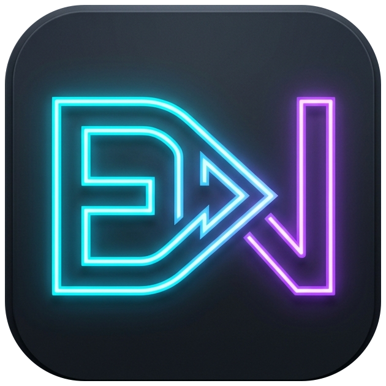

# ENCLip - Video AI Clipper

<p align="center">
  
</p>

<p align="center">
  <b>Aplikasi Desktop Native AI untuk Pemotongan & Pembuatan Konten Video Viral Otomatis</b><br>
  <i>100% Offline dengan Model Lokal (Whisper & Qwen GGUF) atau Cloud Super Cepat via Google Gemini 3.8 Flash</i>
</p>

---

## 🚀 Sekilas Tentang ENCLip

**ENCLip** adalah aplikasi desktop native (Windows) yang dirancang untuk mempermudah kreator konten, streamer, podcaster, dan video editor dalam mengubah video berdurasi panjang menjadi klip-klip highlight vertikal (Shorts, TikTok, Reels) atau klip tematik secara otomatis.

Berbeda dari layanan web berbasis langganan bulanan yang mahal, ENCLip berjalan **langsung di komputer Anda**:
- **Bebas Biaya & Tanpa Watermark**: Semua pemrosesan berlangsung lokal di perangkat Anda.
- **Privasi Terjaga**: Video tidak diunggah ke server pihak ketiga saat menggunakan model lokal.
- **Dukungan Hybrid AI**: Gunakan model AI lokal (Whisper & Qwen GGUF) untuk kerja 100% offline, atau Google Gemini Cloud untuk analisis secepat kilat.

---

## ✨ Fitur Unggulan

### 1. 100% Native Desktop & Clean Interface
- Tampilan modern, responsif, dan elegan berbasis **PyQt6**.
- **Tanpa CMD Pop-up**: Semua proses latar belakang (FFmpeg, Whisper, PyTorch) dieksekusi tanpa jendela hitam yang mengganggu.
- **Terminal Terpadu**: Dilengkapi panel laci `[ ⌨ Terminal ]` di dalam aplikasi untuk memantau proses ekstraksi, transcoding, dan AI secara real-time.

### 2. Transkripsi Suara & Deteksi AI
- **Speech-to-Text Presisi**: Menggunakan model *Faster-Whisper* (Small, Medium, Large-v3) atau *Google Gemini Audio*.
- **Penyaring Momen AI**: Mengenali hook video, reaksi streamer, blunder, punchline lucu, materi berbobot, atau kesimpulan penting.
- **Berbagai Profil Konten**:
  - *Otomatis*: AI mendeteksi tipe konten secara mandiri.
  - *Live / Streamer*: Menargetkan aksi heboh, teriakan, clutch, momen lucu, dan blunder.
  - *Konten Edukasi / Terstruktur*: Menargetkan hook informatif, opini tajam, dan kesimpulan.
  - *Manual Review*: Transkripsi dibuat penuh, Anda bebas menentukan titik klip di tab Review.

### 3. Katalog Download Model AI Lokal Bawaan
- Dilengkapi tab **Model AI Lokal** untuk mengunduh model langsung dari aplikasi dengan rekomendasi spesifikasi:
  - **Qwen 2.5 0.5B Instruct GGUF (~397 MB)**: Sangat ringan, cocok untuk laptop dual-core & RAM 4 GB.
  - **Qwen 2.5 1.5B Instruct GGUF (~1.1 GB)**: Keseimbangan ideal kecepatan & akurasi untuk RAM 8 GB.
  - **Qwen 2.5 7B Instruct GGUF (~4.7 GB)**: Penalaran mendalam setara AI Cloud untuk PC/GPU 16 GB+.
  - **Faster-Whisper Small (~460 MB)**: Transkripsi audio cepat untuk percakapan harian.
  - **Faster-Whisper Medium (~1.5 GB)**: Presisi tinggi untuk audio dengan musik latar belakang.

### 4. Format Output & Auto-Framing Fleksibel
- **Rasio Aspek Output**: 
  - `9:16` · Shorts / Reels / TikTok (Vertikal)
  - `16:9` · Landscape YouTube
  - `1:1` · Square Instagram
  - `4:3` · Format Klasik
- **Framing Cerdas**: Pilihan *Full Video + Background Blur* (aman untuk footage beragam) atau *Crop Memenuhi Frame*.
- **Akselerasi GPU**: Otomatis mendeteksi dan memanfaatkan encoder GPU (Nvidia NVENC, Intel QSV, AMD AMF) untuk render ultra-cepat.

### 5. Styling Subtitle Dinamis (Hardsub)
- 7+ Gaya Subtitle: *Bold, Highlight, Neon, Karaoke, Box, Classic, Minimal*.
- Posisi Teks Fleksibel: Otomatis, Atas, Tengah, Bawah, atau **Bebas (seret langsung di preview video)**.
- Dukungan warna teks kustom (kode HEX seperti `#FFDD00`).

### 6. Kontrol Render & Penguncian Aman
- Semua input dikunci selama render berjalan untuk mencegah konflik pengaturan.
- Dilengkapi tombol **✕ Batal & Edit Kembali** untuk menghentikan proses yang sedang berlangsung secara instan dan membuka kembali pengaturan video.

---

## 🛠️ Persyaratan Sistem

- **Sistem Operasi**: Windows 10 / Windows 11 (64-bit)
- **Python**: Versi 3.10 atau lebih baru (jika menjalankan dari source code)
- **RAM**: Minimal 4 GB (Disarankan 8 GB ke atas)
- **Penyimpanan**: Minimal 2 GB ruang kosong (tambahan ruang sesuai ukuran model AI yang diunduh)
- **GPU (Opsional)**: Nvidia GeForce (GTX/RTX) dengan CUDA untuk akselerasi rendering hardware

---

## 📦 Panduan Instalasi & Menjalankan

### Cara 1: Menjalankan dari Source Code (Paling Cepat)

1. **Clone repository ini**:
   ```bash
   git clone https://github.com/EdvanVPRoject/ENCLip.git
   cd ENCLip
   ```

2. **Jalankan Setup Otomatis (Sekali Klik)**:
   Cukup klik dua kali pada file:
   ```cmd
   install_dependencies.bat
   ```
   *Skrip ini otomatis membuat virtual environment `.venv`, mengupgrade pip, dan memasang seluruh dependensi yang dibutuhkan.*

3. **Buka Aplikasi**:
   Cukup klik dua kali pada file:
   ```cmd
   start.bat
   ```
   *Aplikasi akan langsung terbuka secara native. Saat aplikasi dibuka, tab **Setup Environment & Dependensi** langsung memeriksa seluruh kesiapan sistem secara interaktif.*

---

### Cara 2: Kompilasi ke File Executable (.exe)

Jika Anda ingin membuat versi file `.exe` mandiri untuk didistribusikan:

1. Pastikan langkah setup dependensi di atas sudah selesai.
2. Jalankan skrip kompilasi:
   ```cmd
   build_desktop.bat
   ```
3. Hasil kompilasi `.exe` siap digunakan di folder:
   ```
   Desktop_UI\dist\ENCLip\ENCLip.exe
   ```

---

## 🔑 Cara Mendapatkan Google Gemini API Key (100% Gratis)

Jika Anda ingin menggunakan pemrosesan AI Cloud super cepat tanpa membebani CPU/GPU lokal:

1. Buka situs resmi **[Google AI Studio](https://aistudio.google.com/)** di browser Anda.
2. Login menggunakan akun Google Anda.
3. Klik tombol **Get API key** di pojok kiri atas.
4. Klik **Create API key** > Pilih atau buat project Google Cloud gratis baru.
5. Salin (Copy) string kunci API yang muncul (berawalan `AIzaSy...`).
6. Di ENCLip, buka tab **Buat clip**, pilih Penyedia AI **Google Gemini Pro (Cloud)**, lalu tempel (Paste) di kolom **API Key**.
7. Klik tombol **Tes**. Setelah berhasil diverifikasi, kunci API akan otomatis tersimpan untuk penggunaan berikutnya.

*Catatan: Kuota gratis Google AI Studio sangat besar (ribuan request per hari) dan 100% gratis tanpa memerlukan kartu kredit.*

---

## 📁 Struktur Direktori Proyek

```
ENCLip/
├── Backend_API/            # Mesin pemrosesan video, transkripsi & AI evaluator
│   └── web_server.py       # Core orchestrator, audio extraction, FFmpeg caller
├── Desktop_UI/             # Antarmuka Desktop Native (PyQt6)
│   ├── desktop_gui.py      # Main GUI application, video preview canvas, terminal
│   ├── icon.ico / icon.png # Asset ikon aplikasi
│   └── VanClipper.spec     # Konfigurasi PyInstaller build
├── Core_Data/              # Folder penyimpanan lokal (diabaikan oleh git)
│   ├── models/             # Lokasi model GGUF & Whisper lokal
│   ├── VideoMentah/        # Lokasi video sumber yang diimpor/diunduh
│   └── HasilClip/          # Lokasi hasil potongan klip video per folder
├── requirements.txt        # Daftar dependensi Python
├── setup_environment.bat   # Skrip setup otomatis environment & dependensi
├── run_desktop.bat         # Shortcut menjalankan aplikasi langsung
├── build_desktop.bat       # Skrip kompilasi aplikasi ke .exe
└── README.md               # Dokumentasi lengkap proyek
```

---

## ⚖️ Lisensi

Proyek ini dirilis di bawah lisensi [MIT License](LICENSE). Bebas digunakan, dimodifikasi, dan dikembangkan untuk kebutuhan pribadi maupun komersial.
